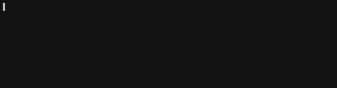

# Rdcli

[](https://www.npmjs.com/package/rdcli)
[](https://raw.githubusercontent.com/johackim/rdcli/master/LICENSE.txt)

The simple way to download and unrestrict DDL files, torrents and magnets.

[](https://raw.githubusercontent.com/johackim/rdcli/master/screencast.gif)

## 📋 Requirements

- Node.js >= 22.12.0

## 📦 Installation

```bash
npm i -g rdcli
```

And set your real-debrid account as environment variables on your `~/.bashrc`

```bash
export REALDEBRID_USERNAME=your_username
export REALDEBRID_PASSWORD=your_password
```

## 📖 Usage

```txt
Usage: rdcli <url|magnet|torrent>

Download links, magnets and torrent files.

Options:
  -V, --version  output the version number
  -p, --print    Print unrestricted link only
  -h, --help     display help for command
```

## 🧪 Running the tests

```bash
npm test
```

## 🎁 Support me

Please support me with a one-time or a monthly donation and help me continue my activities.

[](https://github.com/sponsors/johackim/)

## 📜 License

This project is licensed under the GNU GPL v3.0 - see the [LICENSE.txt](https://raw.githubusercontent.com/johackim/rdcli/master/LICENSE.txt) file for details

**Free Software, Hell Yeah!**
